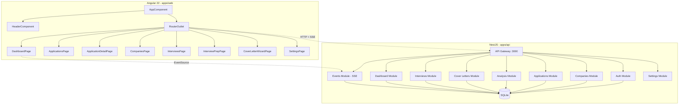

# Architecture — Hermes Job Tracker

## System Diagram

## Data Flow

1. **Authentication:** User registers/logs in → JWT token stored in localStorage → sent as Bearer header
2. **Application Pipeline:** CRUD via NestJS with status machine validation → SSE broadcast on status change
3. **AI Analysis:** POST /api/analysis/match → Strategy Pattern (OpenAI or local fallback) → stored as AIAnalysis entity
4. **Cover Letter Generation:** POST /api/cover-letters/generate → Strategy Pattern → preview/edit/save workflow
5. **Dashboard:** Aggregation queries via TypeORM → KPI computation → SSE real-time updates
6. **SSE Events:** RxJS Subject in EventsService → EventSource in frontend → signal-based state updates

## Key Design Decisions

- **Monorepo structure:** Independent npm projects under apps/ for clean separation and independent build pipelines
- **Signal-first frontend:** All state managed via signals (signal(), computed(), input(), output()) — no zone.js, no NgRx
- **Strategy Pattern for AI:** Interface-based AI providers allow switching between OpenAI and local fallback without code changes
- **Status Machine:** Valid transition map enforces application lifecycle — no invalid states possible
- **SSE over WebSocket:** Simpler for unidirectional real-time; RxJS Subject handles broadcasting
