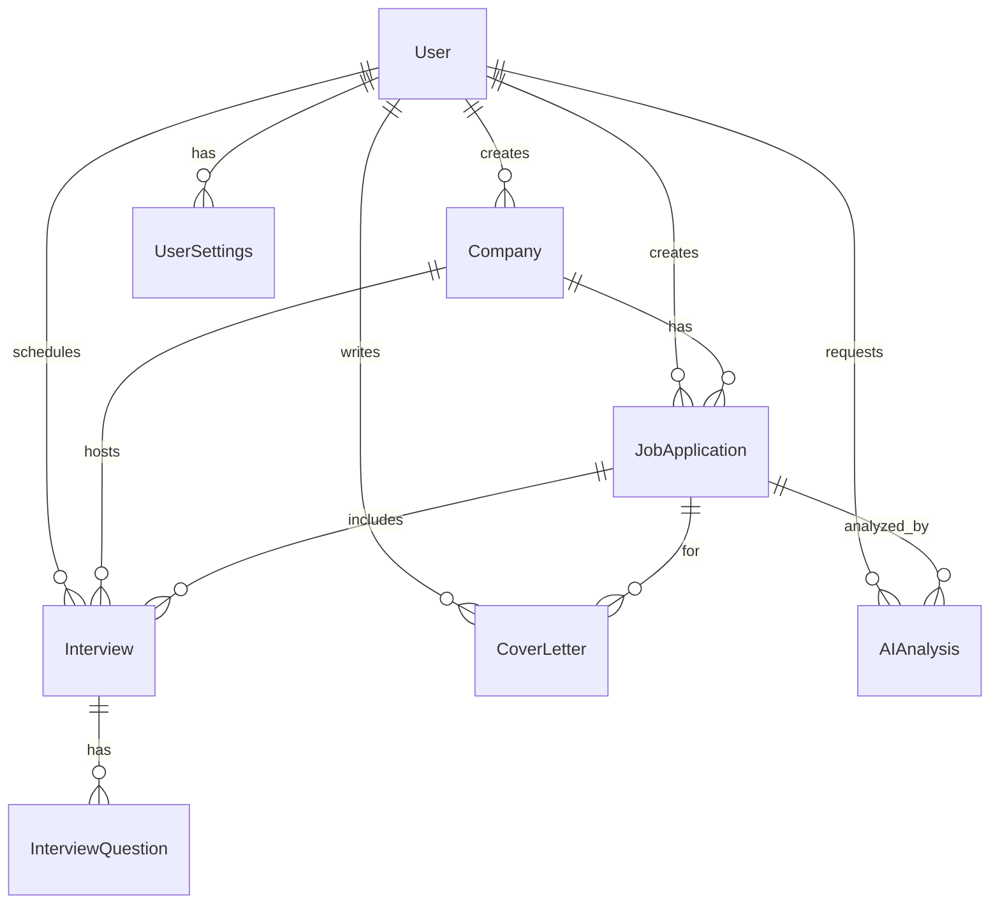
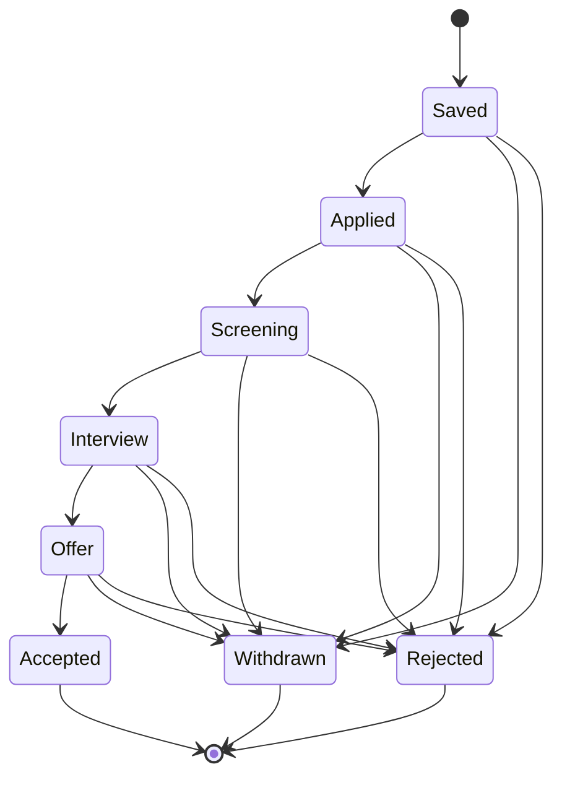

# Database Schema — Hermes Job Tracker

## ER Diagram

## Entities (8)

| Entity | Fields | Relations |
|--------|--------|-----------|
| User | id, email, passwordHash, name, createdAt, updatedAt | 1:M with everything |
| Company | id, userId, name, website?, location?, notes?, contactName?, contactEmail?, contactPhone?, createdAt, updatedAt | M:1 User, 1:M apps + interviews |
| JobApplication | id, userId, companyId, title, description?, salary?, location?, url?, notes?, status, resumeText?, appliedAt?, createdAt, updatedAt | M:1 User, M:1 Company, 1:M interviews/coverLetters/analyses |
| Interview | id, userId, applicationId, companyId, type, dateTime, contactName?, contactEmail?, notes?, prepNotes?, feedback?, completed, createdAt, updatedAt | M:1 User, M:1 Application, M:1 Company, 1:M questions |
| InterviewQuestion | id, interviewId, question, answer?, sortOrder | M:1 Interview |
| CoverLetter | id, userId, applicationId, content, tone, length, version, createdAt | M:1 User, M:1 Application |
| AIAnalysis | id, userId, applicationId, resumeText, matchScore, strengths, gaps, suggestions, modelUsed, createdAt | M:1 User, M:1 Application |
| UserSettings | id, userId, resumeText?, theme, preferences?, updatedAt | 1:1 User |

## Status Machine

## Migration Strategy

- **Dev:** `synchronize: true` with better-sqlite3 — TypeORM auto-creates tables
- **Prod:** Use TypeORM migrations with PostgreSQL — SQL files in `apps/api/migrations/`
- **Neon:** Set `type: 'postgres'` in TypeORM config, use proper connection URL
